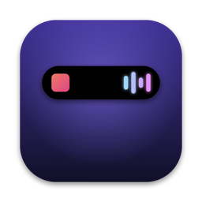
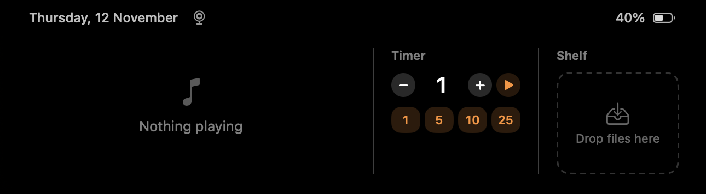

<p align="center"></p>

<h1 align="center">Notch Island</h1>

<p align="center">A Dynamic Island for the MacBook notch. Native Swift, tiny, no accounts, no tracking.</p>

<p align="center"></p>

Hover over the notch and it opens. When something is going on, a small live activity sits beside the notch, the way it does on iPhone.

## Features

- **Now Playing** for any app: Music, Spotify, a browser tab, and others. You get the artwork, a progress bar you can drag to seek, and previous / play-pause / next controls. Click the artwork to jump to the player. While a song plays, bars tinted from the artwork bounce beside the notch.
- **Timer**: pick any number of minutes with − / + or tap 1, 5, 10 or 25. The countdown shows beside the notch. A running timer survives quitting the app and restarting the Mac.
- **Shelf**: drag files or links toward the notch. The island opens as soon as you get close and takes the drop. Drag them out again later, or double-click to open.
- **AirDrop**: while you drag files or links, the island offers an AirDrop target next to the shelf. You can also AirDrop everything on the shelf in one click.
- **Safari tab**: one tap AirDrops the front Safari tab or keeps it on the shelf. A tab dragged along Safari's tab bar never leaves Safari (it's a tab move), so this button stands in for dragging it.
- **Battery**: a flash when the charger is plugged in, and warnings at 20%, 10% and 5%.
- **Bluetooth**: AirPods and other devices show when they connect or disconnect, with battery when available.
- **Trackpad gestures**: with the island open, swipe sideways over the player to change tracks, or swipe up to close.
- **Mirror**: a quick front-camera check before a call. The camera runs only while the mirror is open.
- **Settings**: turn each live activity on or off and pick the hover speed. To open them, right-click the island, or launch the app again while it is running.
- **English and Hebrew**: follows the system language, including right-to-left layout.

Idle, the island draws nothing; the hardware notch is already black. With music playing it measured about 0% CPU, because the animation runs in Core Animation.

## Requirements

- A Mac with a notch: 14″ / 16″ MacBook Pro or 13″ / 15″ MacBook Air. On other Macs it shows as a small pill under the menu bar.
- macOS 15 or later
- Xcode 16+ and [XcodeGen](https://github.com/yonaskolb/XcodeGen) to build

## Build

```bash
brew install xcodegen
git clone https://github.com/dvir9032/NotchIsland.git
cd NotchIsland
```

In `project.yml`, set `DEVELOPMENT_TEAM` to your own Apple team ID. With a free account, use the team Xcode shows under Settings → Accounts. Then build:

```bash
xcodegen generate
xcodebuild -project NotchIsland.xcodeproj -scheme NotchIsland -configuration Release -derivedDataPath build build
cp -R build/Build/Products/Release/NotchIsland.app /Applications/
open /Applications/NotchIsland.app
```

To start it with your Mac, turn on "Launch at login" in Settings.

## How Now Playing works on macOS 15.4+

Since macOS 15.4, the private MediaRemote framework returns nothing to apps that aren't Apple-signed. Notch Island ships a small helper library, `NIHelper.dylib`, that runs inside the system's `/usr/bin/perl`, which is Apple-signed. The helper loads it with `DynaLoader` and streams Now Playing updates to the app as JSON lines; commands go back over stdin. If the helper keeps failing, the app backs off and gives up instead of looping. [mediaremote-adapter](https://github.com/ungive/mediaremote-adapter) pioneered the same idea.

## Permissions

| Permission | Why |
|---|---|
| Bluetooth | To notice devices connecting, and read AirPods battery |
| Camera | Only for the mirror, only while it is open |
| Automation (Safari) | Only when you tap the Safari tab button, to read the front tab's address |

No Accessibility or Screen Recording permission is needed.

## Project layout

```
NotchIsland/          the app (SwiftUI + AppKit)
  IslandController    the panel over the notch, hover, drags and swipes
  IslandModel         state and which live activity wins
  IslandView          all the UI
  MediaController     talks to the perl-hosted Now Playing helper
  Battery, Bluetooth, IslandTimer, Shelf, Mirror, Settings
NIHelper/             the MediaRemote bridge (Objective-C)
scripts/make_icon.swift   draws the app icon
```

## Credits

Ideas from [boring.notch](https://github.com/TheBoredTeam/boring.notch), [Atoll](https://github.com/Ebullioscopic/Atoll) and [NotchDrop](https://github.com/Lakr233/NotchDrop). The code here is written from scratch.

## License

MIT. See [LICENSE](LICENSE).
