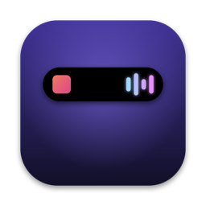
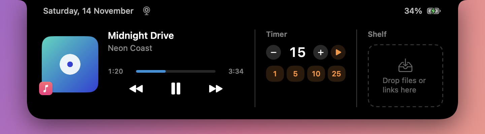

<p align="center"></p>

<h1 align="center">Notch Island</h1>

<h3 align="center">Your MacBook's notch, finally pulling its weight.</h3>

<p align="center">
  A Dynamic Island for macOS: music, timers, files and AirDrop, living right where the notch is.<br>
  Native, featherweight, private. And free.
</p>

<p align="center">
  <a href="https://github.com/dvir9032/NotchIsland/releases/latest"></a>
</p>

<p align="center">
  
  
  
  
</p>

<p align="center"></p>

---

## Meet your new notch

The notch has been sitting at the top of your screen doing nothing. **Notch Island turns it into a live, glanceable hub**, the way the Dynamic Island works on iPhone.

Hover over it and it blooms open. When something's happening, like a song playing, a timer running or AirPods connecting, a small live activity sits beside the notch. When nothing is, it disappears completely: idle, it draws nothing at all.

<p align="center"></p>

## What it does

| | |
|---|---|
| 🎵 **Now Playing, from anything** | Music, Spotify, YouTube in a browser: if it plays, the island shows it. Artwork, a scrubbable progress bar and controls, plus bars beside the notch that dance in the album's colors. |
| ⏱ **A timer that's always in view** | Set any length with − / +, or tap 1, 5, 10 or 25. The countdown sits beside the notch and keeps going even through a restart. |
| 🗂 **A shelf for your files** | Drag files or links toward the notch. The island opens to catch them. They wait there until you drag them out where you need them. |
| 📡 **AirDrop in one move** | Drop a file on the island's AirDrop target and it's on its way to your iPhone. No Share menu, no Finder detour. |
| 🎧 **AirPods & Bluetooth** | See when your headphones connect, with their battery level. |
| 🔋 **Battery at a glance** | A flash of green when you plug in, and a heads-up at 20%, 10% and 5%. |
| 👆 **Trackpad gestures** | Swipe sideways over the player to skip tracks. Swipe up to tuck the island away. |
| 🪞 **Mirror** | Check your hair before the call. The camera turns on only while the mirror is open. |
| ⚙️ **Make it yours** | Pick what shows beside the notch and how fast it opens. |

<p align="center"></p>

## Built to disappear

- **~0% CPU.** Even while music plays, the animation runs on Core Animation, not your battery.
- **Private by design.** No account, no analytics, no network calls. Your music and files never leave your Mac.
- **Trusted.** Signed with Developer ID and notarized by Apple, so it opens without warnings.
- **Tiny.** A 2 MB download, native Swift, no Electron.
- **Feels like Apple made it.** Spring animations, a light overshoot on open, and content that blooms out of the notch and folds back into it.

## Install in 30 seconds

1. **[Download NotchIsland-1.0.zip](https://github.com/dvir9032/NotchIsland/releases/latest)**
2. Unzip it and drag **Notch Island** to **Applications**.
3. Open it and hover over your notch. ✨

To start it with your Mac, right-click the island → **Settings…** → **Launch at login**.

## FAQ

<details>
<summary><b>Is it really free?</b></summary>

Yes. Notch Island is free and open source under the MIT license.
</details>

<details>
<summary><b>Which Macs does it work on?</b></summary>

Any Mac on macOS 15 or later. It shines on MacBooks with a notch (14″/16″ MacBook Pro, 13″/15″ MacBook Air). On other Macs it appears as a small pill under the menu bar.
</details>

<details>
<summary><b>Does it work with Spotify / YouTube / Apple Music?</b></summary>

Yes, with anything that shows up in macOS's Now Playing, including browser tabs.
</details>

<details>
<summary><b>Why isn't it on the Mac App Store?</b></summary>

Showing what's playing in any app needs a private macOS interface that the App Store doesn't allow. So Notch Island is distributed directly, signed and notarized by Apple.
</details>

<details>
<summary><b>What permissions does it ask for?</b></summary>

| Permission | Why |
|---|---|
| Bluetooth | To notice devices connecting, and read AirPods battery |
| Camera | Only for the mirror, only while it's open |

No Accessibility, no Screen Recording, no Full Disk Access.
</details>

## Love it?

⭐ **Star the repo.** It helps other Mac users find Notch Island.
Found a bug or have an idea? [Open an issue](https://github.com/dvir9032/NotchIsland/issues).

---

<details>
<summary><b>For developers: build from source</b></summary>

You need Xcode 16+ and [XcodeGen](https://github.com/yonaskolb/XcodeGen).

```bash
brew install xcodegen
git clone https://github.com/dvir9032/NotchIsland.git
cd NotchIsland
```

In `project.yml`, set `DEVELOPMENT_TEAM` to your own Apple team ID (Xcode → Settings → Accounts shows it). Then:

```bash
xcodegen generate
xcodebuild -project NotchIsland.xcodeproj -scheme NotchIsland -configuration Release -derivedDataPath build build
cp -R build/Build/Products/Release/NotchIsland.app /Applications/
```

`scripts/release.sh` builds the signed, notarized zip for a release.
</details>

<details>
<summary><b>For developers: how Now Playing works on macOS 15.4+</b></summary>

Since macOS 15.4, the private MediaRemote framework returns nothing to apps that aren't Apple-signed. Notch Island ships a small helper library, `NIHelper.dylib`, that runs inside the system's `/usr/bin/perl`, which is Apple-signed. The helper loads it with `DynaLoader` and streams Now Playing updates to the app as JSON lines; commands go back over stdin. If the helper keeps failing, the app backs off instead of looping. [mediaremote-adapter](https://github.com/ungive/mediaremote-adapter) pioneered the same idea.

```
NotchIsland/          the app (SwiftUI + AppKit)
  IslandController    the panel over the notch, hover, drags and swipes
  IslandModel         state and which live activity wins
  IslandView          all the UI and motion
  MediaController     talks to the perl-hosted Now Playing helper
  Battery, Bluetooth, IslandTimer, Shelf, Mirror, Settings
NIHelper/             the MediaRemote bridge (Objective-C)
scripts/              release.sh, make_icon.swift
```
</details>

<p align="center"><sub>Inspired by <a href="https://github.com/TheBoredTeam/boring.notch">boring.notch</a>, <a href="https://github.com/Ebullioscopic/Atoll">Atoll</a> and <a href="https://github.com/Lakr233/NotchDrop">NotchDrop</a>. Written from scratch. MIT licensed.</sub></p>
